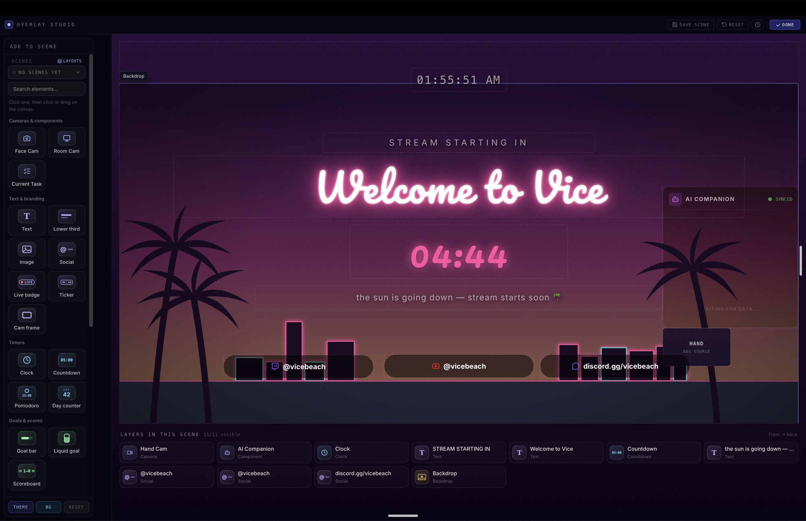
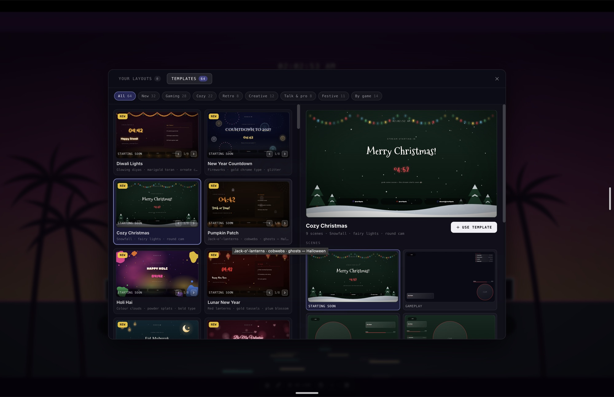

# Overlay Studio

[](LICENSE)
[](https://streamoverlay.kazekit.com)

**A free stream overlay editor for OBS that runs in your browser.** Design your overlay on a live canvas, then add it to OBS with one link. Nothing to install, no sign-up.

**[▶ Open the studio](https://streamoverlay.kazekit.com/?studio)** · [Website](https://streamoverlay.kazekit.com) · [Request a component](https://github.com/abhayraghuwanshi/overlay-studio/issues/new/choose) · [Report a bug](https://github.com/abhayraghuwanshi/overlay-studio/issues/new?template=bug_report.yml)



Works with OBS Studio, Streamlabs Desktop, XSplit, Meld Studio or any app with a browser source. Stream to Twitch, YouTube, Kick, or anywhere else.

If it's useful, a ⭐ helps other streamers find it. Built live on stream: [watch the build](https://www.youtube.com/watch?v=EYx6zFFJDyE).

> This is the official repository. [streamoverlay.kazekit.com](https://streamoverlay.kazekit.com) is the only official hosted version.

## Features

- **Drag-and-drop editor:** cameras, text and widgets on a 16:9 canvas, no code.
- **One link for OBS:** edits show up in OBS within seconds.
- **64 templates:** Gaming, Cozy, Retro, Creative, Talk, Festive and game-inspired packs, each with Starting Soon, Gameplay, BRB, Ending and more. [See them on YouTube](https://www.youtube.com/watch?v=q4j-2mfvl9E&list=PLU64EFJph6SA).
- **Themes:** re-skin everything in one click, including animated backdrops, text effects and cam frames.
- **Twitch alerts, event list and chat:** subs, gifts, raids and cheers, no login needed.
- **Widgets:** goals, countdowns, clock, pomodoro, ticker, lower thirds, socials, sticky notes, spin wheel, live match scoreboard, pets and more.
- **Camera cut-outs:** backgrounds leave a see-through hole where your OBS camera sits.
- **Camera auto-placement (optional):** with OBS WebSocket on, your webcam snaps into the overlay's frame on every scene switch.



▶ **[Watch the templates in action](https://www.youtube.com/watch?v=q4j-2mfvl9E&list=PLU64EFJph6SA)** (YouTube playlist)

## Quick start

1. Open **[the studio](https://streamoverlay.kazekit.com/?studio)** and pick a template or start blank.
2. Click **Go Live** to copy your OBS link.
3. In OBS: **Sources → + → Browser**, paste the link, and set **1920 × 1080**.
4. Keep editing in the browser. OBS updates by itself.


> **Keep your link private.** Anyone with it can view and edit that overlay.
>
> Webcams and screen captures go in OBS as normal sources (Video Capture Device / Display Capture), behind the overlay.

### Camera auto-placement

In OBS, open **Tools → WebSocket Server Settings**, turn on **Enable WebSocket server** (port **4455**) and turn off authentication. The studio's camera panel shows **OBS connected**. With several cameras, put `face`, `hand` or `room` in their OBS source names.

## Run it locally

Needs [Node.js](https://nodejs.org/) 20+.

```bash
npm install
npm run dev        # http://localhost:3377
```

| Folder | What's in it |
| --- | --- |
| `src/` | The React + Vite app: home page, studio, and the overlay OBS shows |
| `api/` | Serverless functions: room storage, match feed, stats |
| `backend/` | Optional local AI chat companion (`cd backend && node server.js`) |
| `scripts/` | SEO pages and promo-video recording (`npm run promo`) |
| `docs/` | Contributor guides |

To deploy your own copy, see **[DEPLOY.md](DEPLOY.md)**.

## Running your own version

You can host your own version, commercial or not, if you:

1. **Publish your source code** under the [AGPL-3.0](LICENSE), including your changes. A public fork linked from your app is enough.
2. **Use your own name and branding.** See [TRADEMARKS.md](TRADEMARKS.md). Change these files:

| File | Change |
| --- | --- |
| `index.html` | Title, description, social preview tags |
| `public/favicon.svg` | Favicon / logo |
| `seo.config.js` | Site URL, brand name, GitHub link |
| `src/components/LandingPage.jsx`, `src/components/Showcase.jsx` | Product name and links |
| `src/analytics.js` | Set `VITE_GA_ID` to your own ID, or empty to turn analytics off |
| `public/robots.txt`, `.github/ISSUE_TEMPLATE/config.yml` | Links to the official site |
| `.sitelens.yml` | Delete it |

"Based on Overlay Studio" with a link back here is welcome.

## Contributing

Issues and pull requests are welcome. For anything big, open an issue first.

- [Request a component, theme or feature](https://github.com/abhayraghuwanshi/overlay-studio/issues/new/choose) (also in the studio's Help panel)
- [Creating a new backdrop](docs/creating-a-backdrop.md)

By sending a pull request, you agree your contribution is licensed under the AGPL-3.0 and that the project owner may also license it under other terms (for example, a commercial license).

## License

Copyright (c) 2026 Abhay Raghuwanshi. Code under the [GNU AGPL-3.0](LICENSE). The names and logo are not licensed; see [TRADEMARKS.md](TRADEMARKS.md).

For a commercial license or a custom overlay for your channel, email [raghuwanshi.abhay405@gmail.com](mailto:raghuwanshi.abhay405@gmail.com).
